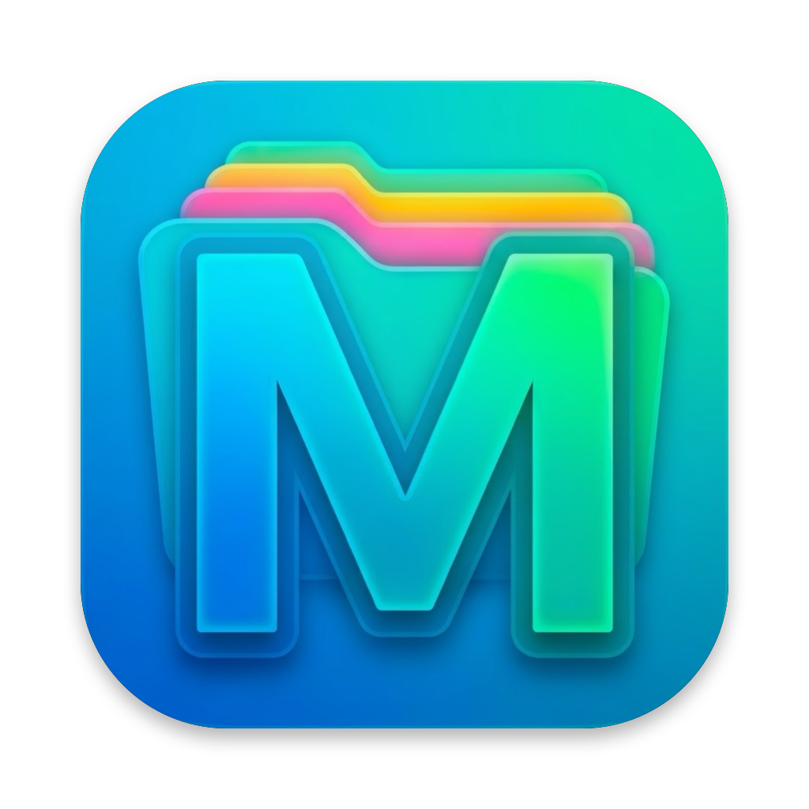
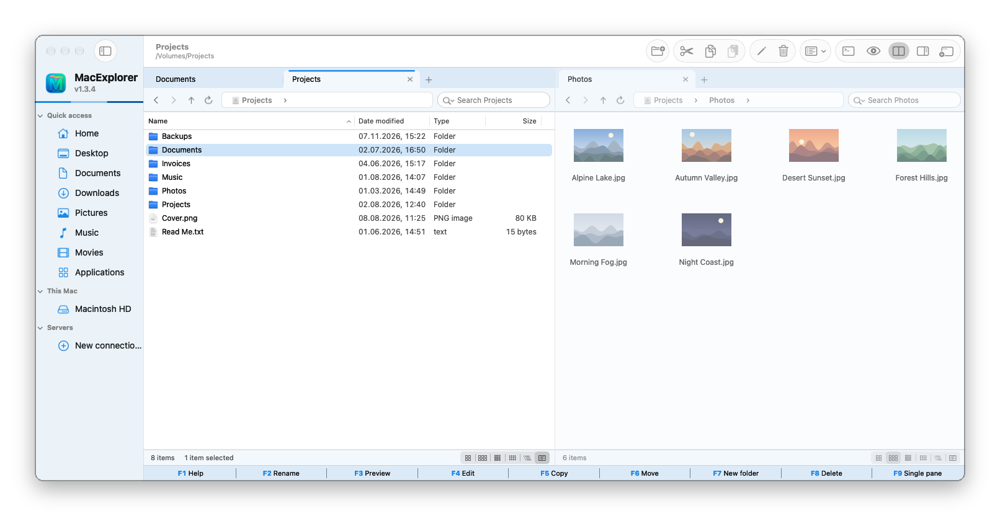
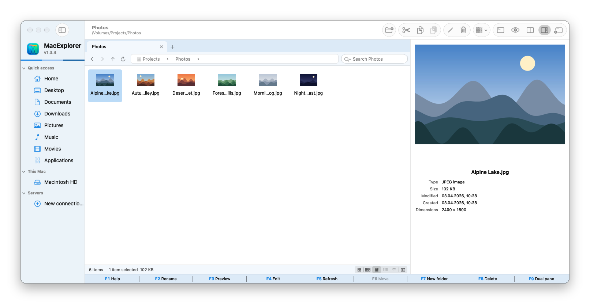
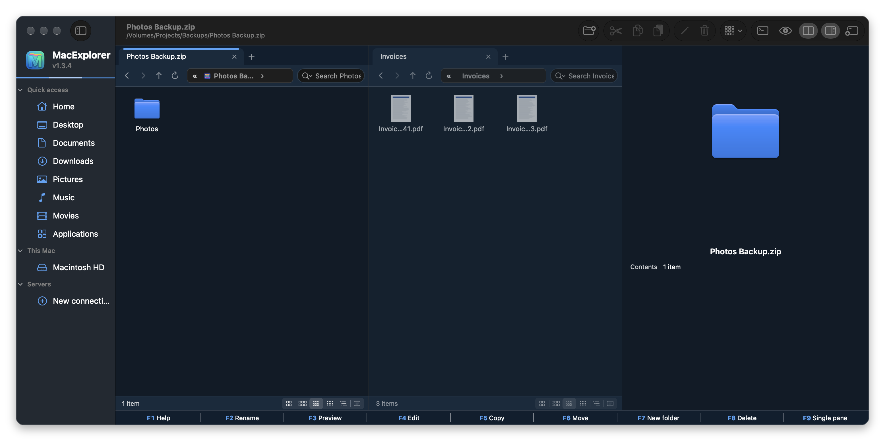
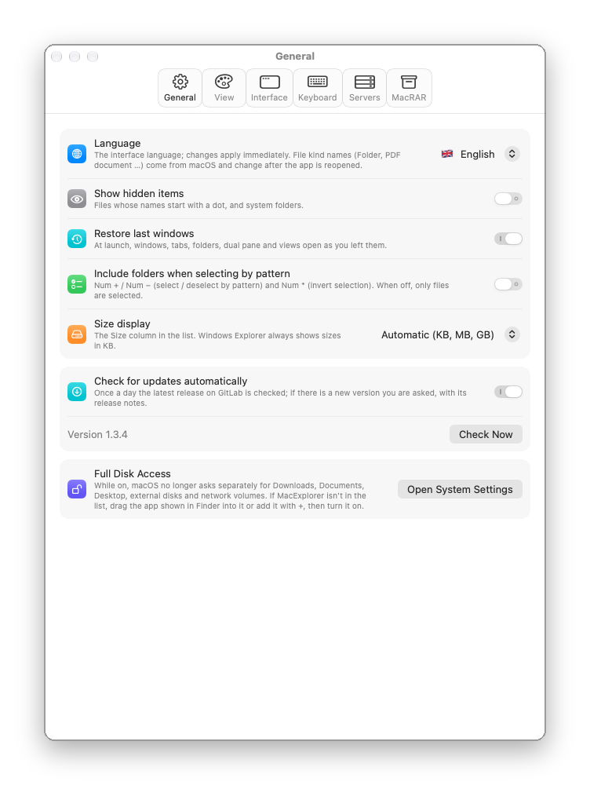
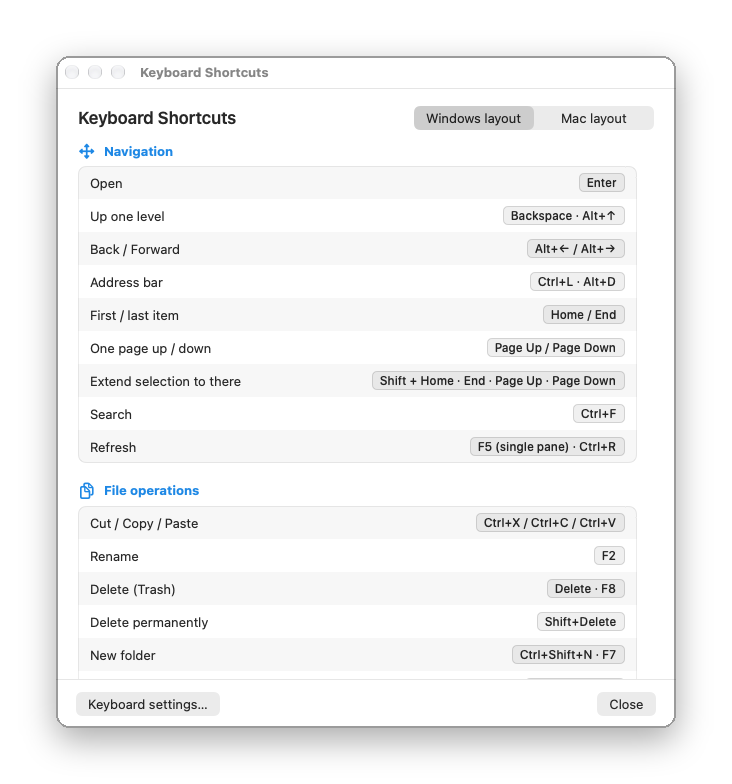

<p align="center">
  
</p>

<h1 align="center">MacExplorer</h1>

<p align="center">
  A free, open-source, <b>Windows Explorer-style file manager</b> for macOS: tabs, dual pane, real Cut / Paste, a preview pane and SFTP / FTP right in the window.<br>
  Written in Swift (AppKit and SwiftUI); no Electron.
</p>

<p align="center">
  A free alternative to <b>Finder</b>, <b>Path Finder</b>, <b>ForkLift</b> and <b>Commander One</b> for people who miss Windows Explorer on the Mac.
</p>

<p align="center">
  <b>🇬🇧 English</b> · <a href="README.tr.md">🇹🇷 Türkçe</a>
</p>

<p align="center">
  <a href="https://gitlab.com/freeware2/macexplorer/-/releases/permalink/latest/downloads/MacExplorer.zip"></a>
</p>

<p align="center">
  <a href="https://macfreeware.github.io/macexplorer/">Website</a> · <a href="https://gitlab.com/freeware2/macexplorer/-/releases">All releases</a> · <a href="#download-and-install">Installation steps</a> · <a href="#faq">FAQ</a>
</p>

> [!warning] The first time you open MacExplorer, macOS blocks it. This is expected.
> MacExplorer is free and not notarized by Apple, so the first time you open it macOS says it *could not verify* the app. You only need to allow it once:
>
> 1. In the warning, click **Done**. Do **not** click *Move to Trash*.
> 2. Open **System Settings ▸ Privacy & Security** and scroll down to **Security**.
> 3. On the line saying MacExplorer was blocked, click **Open Anyway** and confirm with your password or Touch ID.
>
> Prefer Terminal? Run `xattr -dr com.apple.quarantine /Applications/MacExplorer.app`, then open MacExplorer.

## Screenshots

### ⭐ Tabs and dual pane

Every pane has its own tabs, and each tab keeps its own folder and view. Details on the left, large thumbnails on the right. The address bar, the Windows column names and the function key bar at the bottom will feel familiar if you come from Windows.

<p align="center"></p>

### Preview pane

Alt+P opens a large preview of the selection, with its type, size, dates and, for photos, dimensions, camera and location.

<p align="center"></p>

### Archives like folders, light and dark

Double-click a ZIP to go inside, like in Explorer, and copy files out with F5. Choose from 14 themes, each with light and dark colours.

<p align="center"></p>

### Settings and keyboard shortcuts

Windows keyboard behaviour by default, Mac behaviour if you prefer it. F1 lists every shortcut.

<p align="center">
  
  &nbsp;
  
</p>

<p align="center"><sub>Screenshots from the English interface, with sample files. You can switch to Turkish in Settings without restarting.</sub></p>

## Features

**Window and navigation**
- Sidebar with Quick access, disks and saved servers; Back / Forward / Up / Refresh
- Address bar with steps like Explorer; **›** lists subfolders, and you can type a path (⌘L / Ctrl+L / Alt+D)
- Windows, tabs, folders and views come back as you left them
- Tabs that move like in Firefox: reorder, drag to the other pane or to another window, or drop outside for a new window
- Dual pane (F9); Tab switches between panes

**Views and preview**
- Extra large / Large / Medium / Small icons, List and Details, with thumbnails of images, PDFs and videos
- Details with Windows column names, folders first, natural sort
- Preview pane (Alt+P) and Quick Look (F3 or ⌘Y)
- Type to select, rubber-band selection

**File operations**
- **Real Cut / Copy / Paste** (Ctrl+X/C/V or ⌘X/C/V), and it works with Finder's clipboard in both directions
- Copy and move with a progress window, Cancel and **Replace / Skip / Keep both**
- **F5 / F6** copy / move to the other pane, drag and drop with Finder
- **Undo / Redo** for every file operation, shared by all windows
- Keyboard multi-select like Total Commander (Space / Insert); select by pattern with Num + (`*.pdf; report*`)
- Zip files with UTF-8 names and without `__MACOSX`, so non-English file names open correctly on Windows

**Search**
- Filters the current folder at once and also searches subfolders in the background; case and accent insensitive

**Right-click menu**
- Windows names: Open with, Send to, Copy as path, Create shortcut, Properties (Alt+Enter), Open in Terminal and more

**Servers**
- **SMB (Windows / NAS), WebDAV, AFP, NFS** mounted by macOS like a disk
- **SFTP, FTP, FTPES, FTPS** open right in the pane: browse, copy both ways, drag and drop, rename, delete
- Copy between servers; on the same SFTP server the copy runs on the server itself
- SFTP with key file, ssh-agent or `~/.ssh/config` hosts; server keys and FTPS certificates are shown before you trust them
- Passwords are kept only in the macOS Keychain

**Archives and disk images**
- Browse ZIP, RAR, 7Z, TAR / TGZ / TBZ / TXZ, CAB, XAR, CPIO and LHA like folders (read-only); extract with F5, drag and drop or copy-paste
- Mount ISO, DMG, IMG and CDR; create ISO (Windows, Linux and Mac) or compressed DMG from a folder
- **[MacRAR](https://gitlab.com/freeware2/macrar)** menu in the right-click menu when MacRAR is installed

**Text editing with [MacNote++](https://gitlab.com/freeware2/macnotepp)**
- F4 opens files in the free MacNote++ editor when no other editor is chosen
- F3 can open files read-only in MacNote++ (Settings ▸ Keyboard); Quick Look stays the default
- Download and install MacNote++ from Settings ▸ Keyboard or the About window

**Keyboard and appearance**
- Windows keyboard behaviour by default (Enter opens, Backspace goes up, Delete, F2, Ctrl shortcuts); Mac behaviour optional
- Home, End, Page Up and Page Down move the selection; function key bar, also on the Touch Bar
- 14 themes; System, Light or Dark appearance; English and Turkish interface
- Self-update from GitLab with SHA-256, app id and signature checks

## Download and install

1. **[Download MacExplorer.zip](https://gitlab.com/freeware2/macexplorer/-/releases/permalink/latest/downloads/MacExplorer.zip)** (macOS 15 or later, Apple Silicon and Intel).
2. Unzip it and move `MacExplorer.app` to **Applications**.
3. Allow it once, as described at the top of this page.
4. Optional: **Settings ▸ General ▸ Full Disk Access** stops macOS from asking separately for Downloads, Documents, Desktop, external disks and network volumes.

### Verifying the download

Download [`MacExplorer.zip.sha256`](https://gitlab.com/freeware2/macexplorer/-/releases/permalink/latest/downloads/MacExplorer.zip.sha256) to the same folder and run:

```bash
shasum -a 256 -c MacExplorer.zip.sha256
```

## Building from source

Requires macOS 15 and the Swift toolchain (Xcode or Command Line Tools).

```bash
git clone https://gitlab.com/freeware2/macexplorer.git
cd macexplorer
scripts/build_app.sh release   # build/MacExplorer.app
swift test                     # core tests
```

## Known limits

- Archives are read-only inside MacExplorer; [MacRAR](https://gitlab.com/freeware2/macrar) edits them.
- Subfolder search is for folders on this Mac; on servers and inside archives the search box filters the current folder.

## FAQ

### Is MacExplorer free?

Yes. It is free and open source under the GPL-3.0 license, with no ads, accounts or in-app purchases.

### Is there a Windows Explorer for Mac?

Microsoft does not make one. MacExplorer brings the same way of working to macOS: tabs, the address bar with steps, Windows menu names, Cut / Paste and the Windows keyboard behaviour.

### Can I cut and paste files on a Mac?

Yes. In MacExplorer, Ctrl+X or ⌘X cuts files and Ctrl+V or ⌘V moves them. Cut items are dimmed until you paste.

### Does it replace Finder?

No, it runs next to Finder. macOS does not reliably allow another app to become the default file viewer, so folders opened from other apps still go to Finder.

### Can it connect to SFTP and FTP servers?

Yes. SFTP, FTP, FTPES and FTPS open in the pane, and SMB, WebDAV, AFP and NFS are mounted as disks. Connect with ⌘K.

### Where are my passwords stored?

Only in the macOS Keychain, and only if you choose to save them.

### Which Macs does it run on?

macOS 15 or later, on Apple Silicon and Intel.

### Why does macOS block it the first time?

MacExplorer is signed with its own certificate but not notarized by Apple, so macOS asks you to allow it once. Permissions you grant are kept across updates.

## License

GPL-3.0. See [LICENSE](LICENSE). Developed by Rafet SAPANCI and Mustafa YILDIRIM. MacExplorer is not affiliated with Microsoft or Apple.
