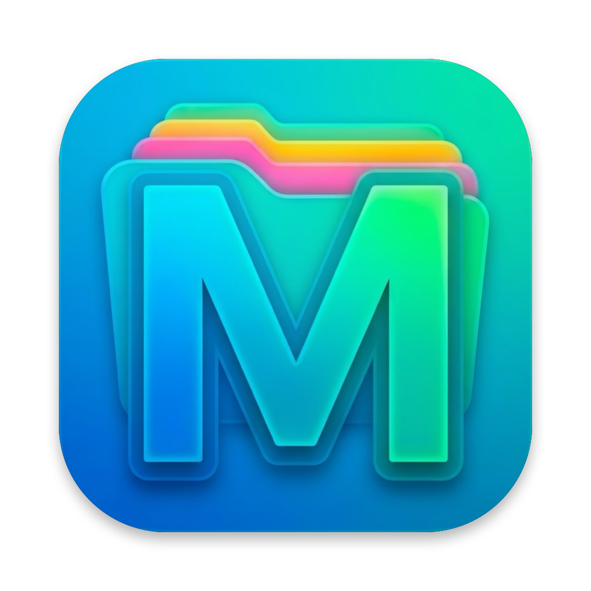
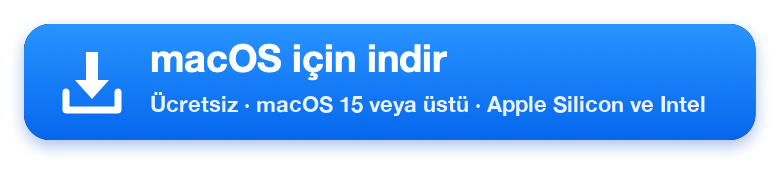
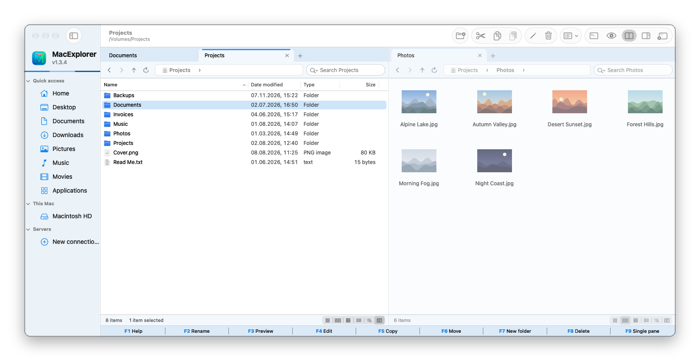
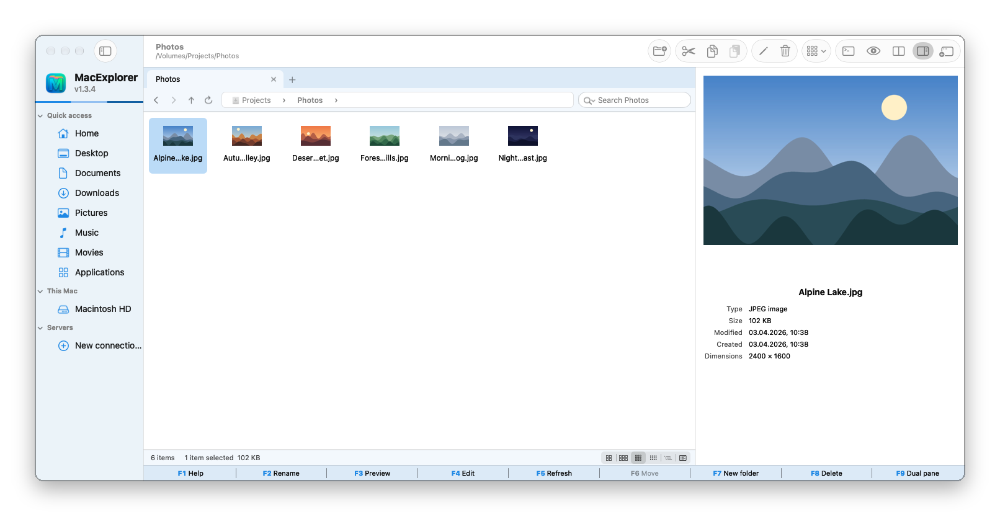
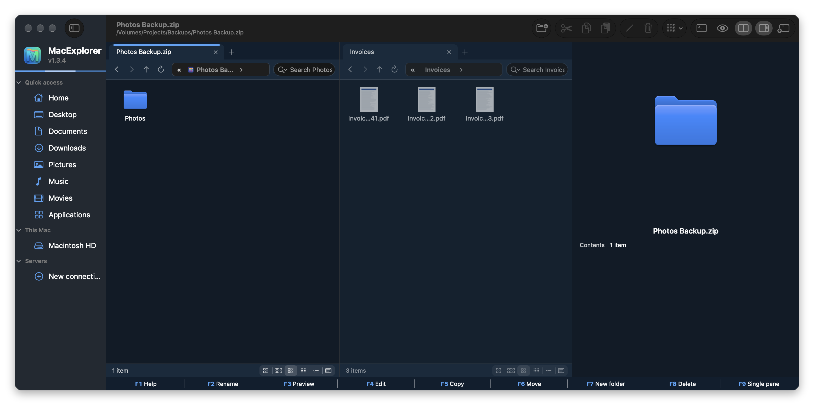
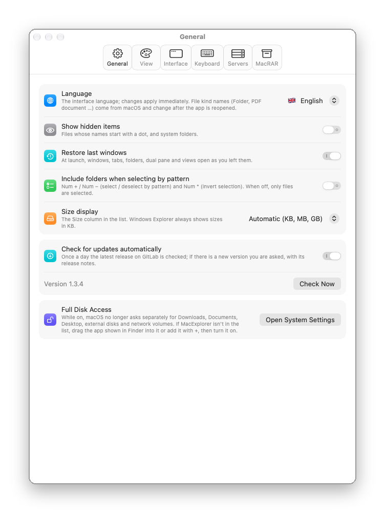
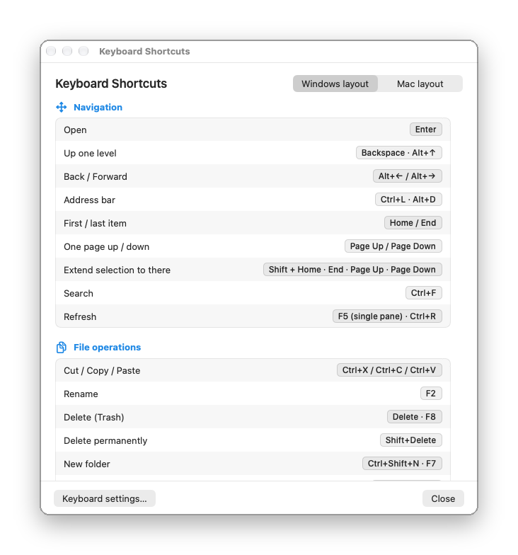

<p align="center">
  
</p>

<h1 align="center">MacExplorer</h1>

<p align="center">
  macOS için ücretsiz, açık kaynak, <b>Windows Gezgini tarzı dosya yöneticisi</b>: sekmeler, çift panel, gerçek Kes / Yapıştır, önizleme bölmesi ve pencerenin içinde SFTP / FTP.<br>
  Swift ile yazıldı (AppKit ve SwiftUI); Electron yok.
</p>

<p align="center">
  Mac'te Windows Gezgini'ni arayanlar için <b>Finder</b>, <b>Path Finder</b>, <b>ForkLift</b> ve <b>Commander One</b>'a ücretsiz bir alternatif.
</p>

<p align="center">
  <a href="README.md">🇬🇧 English</a> · <b>🇹🇷 Türkçe</b>
</p>

<p align="center">
  <a href="https://gitlab.com/freeware2/macexplorer/-/releases/permalink/latest/downloads/MacExplorer.zip"></a>
</p>

<p align="center">
  <a href="https://macfreeware.github.io/tr/macexplorer/">Web sitesi</a> · <a href="https://gitlab.com/freeware2/macexplorer/-/releases">Tüm sürümler</a> · <a href="#indirme-ve-kurulum">Kurulum adımları</a> · <a href="#sık-sorulan-sorular">Sık sorulan sorular</a>
</p>

> [!warning] MacExplorer'ı ilk açtığınızda macOS engeller. Bu beklenen bir durumdur.
> MacExplorer ücretsizdir ve Apple tarafından onaylanmamıştır (notarized değil), bu yüzden ilk açılışta macOS uygulamayı *doğrulayamadığını* söyler. Yalnızca bir kez izin vermeniz yeterli:
>
> 1. Uyarıda **Bitti**'ye tıklayın. **Çöp Sepeti'ne Taşı**'ya tıklamayın.
> 2. **Sistem Ayarları ▸ Gizlilik ve Güvenlik** bölümünü açıp **Güvenlik** başlığına inin.
> 3. MacExplorer'ın engellendiğini söyleyen satırda **Yine de Aç**'a tıklayın ve parolanız ya da Touch ID ile onaylayın.
>
> Terminal'i mi tercih edersiniz? `xattr -dr com.apple.quarantine /Applications/MacExplorer.app` komutunu çalıştırıp MacExplorer'ı açın.

## Ekran görüntüleri

### ⭐ Sekmeler ve çift panel

Her panelin kendi sekmeleri vardır; her sekme kendi klasörünü ve görünümünü korur. Solda ayrıntılar, sağda büyük küçük resimler. Adres çubuğu, Windows sütun adları ve alttaki işlev tuşu çubuğu Windows'tan gelenlere tanıdık gelecek.

<p align="center"></p>

### Önizleme bölmesi

Alt+P seçili öğenin büyük önizlemesini açar; türü, boyutu, tarihleri ve fotoğraflarda boyutlar, kamera ve konum bilgisi de görünür.

<p align="center"></p>

### Klasör gibi arşivler, açık ve koyu görünüm

ZIP dosyasına Gezgin'deki gibi çift tıklayarak girin, dosyaları F5 ile dışarı kopyalayın. Her biri açık ve koyu renkli 14 tema arasından seçim yapın.

<p align="center"></p>

### Ayarlar ve klavye kısayolları

Varsayılan olarak Windows klavye düzeni, isterseniz Mac düzeni. F1 tüm kısayolları listeler.

<p align="center">
  
  &nbsp;
  
</p>

<p align="center"><sub>Görüntüler İngilizce arayüzden ve örnek dosyalarla alındı. Ayarlar'dan yeniden başlatmadan Türkçeye geçebilirsiniz.</sub></p>

## Özellikler

**Pencere ve gezinme**
- Hızlı erişim, diskler ve kayıtlı sunucularla kenar çubuğu; Geri / İleri / Yukarı / Yenile
- Gezgin'deki gibi adımlı adres çubuğu; **›** alt klasörleri listeler, yol da yazabilirsiniz (⌘L / Ctrl+L / Alt+D)
- Pencereler, sekmeler, klasörler ve görünümler bıraktığınız gibi geri gelir
- Firefox'taki gibi taşınan sekmeler: sıralayın, diğer panele ya da başka pencereye sürükleyin, dışarı bırakıp yeni pencere açın
- Çift panel (F9); Tab paneller arasında geçer

**Görünümler ve önizleme**
- Çok büyük / Büyük / Orta / Küçük simgeler, Liste ve Ayrıntılar; resim, PDF ve videolarda küçük resim
- Windows sütun adlarıyla Ayrıntılar, önce klasörler, doğal sıralama
- Önizleme bölmesi (Alt+P) ve Hızlı Bakış (F3 ya da ⌘Y)
- Yazarak seçme, boş alandan sürükleyerek seçme

**Dosya işlemleri**
- **Gerçek Kes / Kopyala / Yapıştır** (Ctrl+X/C/V ya da ⌘X/C/V); Finder panosuyla iki yönlü çalışır
- İlerleme penceresi, İptal ve **Değiştir / Atla / İkisini de sakla** ile kopyalama ve taşıma
- **F5 / F6** diğer panele kopyalar / taşır; Finder'la sürükle bırak
- Tüm dosya işlemleri için **Geri Al / Yinele**, tüm pencerelerde ortak
- Total Commander gibi klavyeyle çoklu seçim (Boşluk / Insert); Num + ile desene göre seçim (`*.pdf; rapor*`)
- UTF-8 adlı ve `__MACOSX` içermeyen zip'ler: Türkçe dosya adları Windows'ta doğru açılır

**Arama**
- Bulunduğunuz klasörü anında süzer, alt klasörleri de arka planda arar; büyük-küçük harf ve aksan duyarsız ("ozet", "Özet.txt"yi bulur)

**Sağ tık menüsü**
- Windows adlarıyla: Birlikte aç, Gönder, Yol olarak kopyala, Kısayol oluştur, Özellikler (Alt+Enter), Terminalde aç ve daha fazlası

**Sunucular**
- **SMB (Windows / NAS), WebDAV, AFP, NFS** macOS tarafından disk olarak bağlanır
- **SFTP, FTP, FTPES, FTPS** doğrudan panelde açılır: gezinme, iki yönlü kopyalama, sürükle bırak, yeniden adlandırma, silme
- Sunucular arası kopyalama; aynı SFTP sunucusunda kopya sunucunun kendisinde yapılır
- Anahtar dosyası, ssh-agent ya da `~/.ssh/config` ile SFTP; sunucu anahtarları ve FTPS sertifikaları güvenmeden önce gösterilir
- Parolalar yalnızca macOS Anahtar Zinciri'nde tutulur

**Arşivler ve disk görüntüleri**
- ZIP, RAR, 7Z, TAR / TGZ / TBZ / TXZ, CAB, XAR, CPIO ve LHA içinde klasör gibi gezinme (salt okunur); F5, sürükle bırak ya da kopyala-yapıştır ile çıkarma
- ISO, DMG, IMG ve CDR bağlama; klasörden ISO (Windows, Linux ve Mac) ya da sıkıştırılmış DMG oluşturma
- **[MacRAR](https://gitlab.com/freeware2/macrar)** kuruluysa sağ tık menüsünde MacRAR komutları

**Klavye ve görünüm**
- Varsayılan olarak Windows klavye davranışı (Enter açar, Backspace yukarı çıkar, Delete, F2, Ctrl kısayolları); Mac davranışı seçilebilir
- Home, End, Page Up ve Page Down seçimi taşır; işlev tuşu çubuğu, Touch Bar'da da
- 14 tema; Sistem, Açık ya da Koyu görünüm; Türkçe ve İngilizce arayüz
- SHA-256, uygulama kimliği ve imza denetimiyle GitLab'dan kendi kendini güncelleme

## İndirme ve kurulum

1. **[MacExplorer.zip dosyasını indirin](https://gitlab.com/freeware2/macexplorer/-/releases/permalink/latest/downloads/MacExplorer.zip)** (macOS 15 ve üstü, Apple Silicon ve Intel).
2. Zip'i açıp `MacExplorer.app`'i **Uygulamalar** klasörüne taşıyın.
3. Bu sayfanın başında anlatıldığı gibi bir kez izin verin.
4. İsteğe bağlı: **Ayarlar ▸ Genel ▸ Tam Disk Erişimi**, macOS'un İndirilenler, Belgeler, Masaüstü, harici diskler ve ağ birimleri için ayrı ayrı sormasını önler.

### İndirmeyi doğrulama

[`MacExplorer.zip.sha256`](https://gitlab.com/freeware2/macexplorer/-/releases/permalink/latest/downloads/MacExplorer.zip.sha256) dosyasını aynı klasöre indirip çalıştırın:

```bash
shasum -a 256 -c MacExplorer.zip.sha256
```

## Kaynaktan derleme

macOS 15 ve Swift araçları (Xcode ya da Command Line Tools) gerekir.

```bash
git clone https://gitlab.com/freeware2/macexplorer.git
cd macexplorer
scripts/build_app.sh release   # build/MacExplorer.app
swift test                     # temel testler
```

## Bilinen sınırlar

- Arşivler MacExplorer içinde salt okunurdur; düzenlemeyi [MacRAR](https://gitlab.com/freeware2/macrar) yapar.
- Alt klasör araması bu Mac'teki klasörler içindir; sunucularda ve arşivlerin içinde arama kutusu yalnızca bulunduğunuz klasörü süzer.

## Sık sorulan sorular

### MacExplorer ücretsiz mi?

Evet. GPL-3.0 lisanslı, ücretsiz ve açık kaynaktır; reklam, hesap ya da uygulama içi satın alma yoktur.

### Mac için Windows Gezgini var mı?

Microsoft yapmıyor. MacExplorer aynı çalışma biçimini macOS'a getirir: sekmeler, adımlı adres çubuğu, Windows menü adları, Kes / Yapıştır ve Windows klavye davranışı.

### Mac'te dosya kesip yapıştırabilir miyim?

Evet. MacExplorer'da Ctrl+X ya da ⌘X dosyaları keser, Ctrl+V ya da ⌘V taşır. Kesilen öğeler yapıştırılana kadar soluk görünür.

### Finder'ın yerini alıyor mu?

Hayır, Finder'ın yanında çalışır. macOS başka bir uygulamanın varsayılan dosya görüntüleyici olmasına güvenilir biçimde izin vermiyor; bu yüzden başka uygulamalardan açılan klasörler yine Finder'a gider.

### SFTP ve FTP sunucularına bağlanabilir mi?

Evet. SFTP, FTP, FTPES ve FTPS panelde açılır; SMB, WebDAV, AFP ve NFS disk olarak bağlanır. ⌘K ile bağlanın.

### Parolalarım nerede saklanıyor?

Yalnızca macOS Anahtar Zinciri'nde ve yalnızca kaydetmeyi seçerseniz.

### Hangi Mac'lerde çalışır?

macOS 15 ve üstünde, Apple Silicon ve Intel işlemcilerde.

### macOS neden ilk seferde engelliyor?

MacExplorer kendi sertifikasıyla imzalıdır ama Apple tarafından onaylanmamıştır, bu yüzden macOS bir kez izin vermenizi ister. Verdiğiniz izinler güncellemelerde korunur.

## Lisans

GPL-3.0. Bkz. [LICENSE](LICENSE). Geliştiren: Rafet SAPANCI ve Mustafa YILDIRIM. MacExplorer'ın Microsoft ya da Apple ile bağlantısı yoktur.
